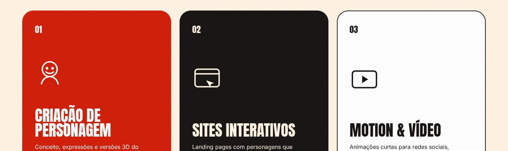
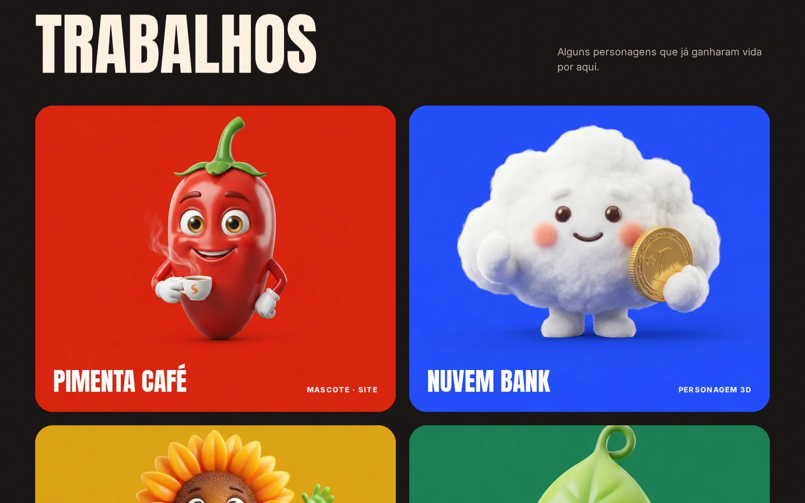
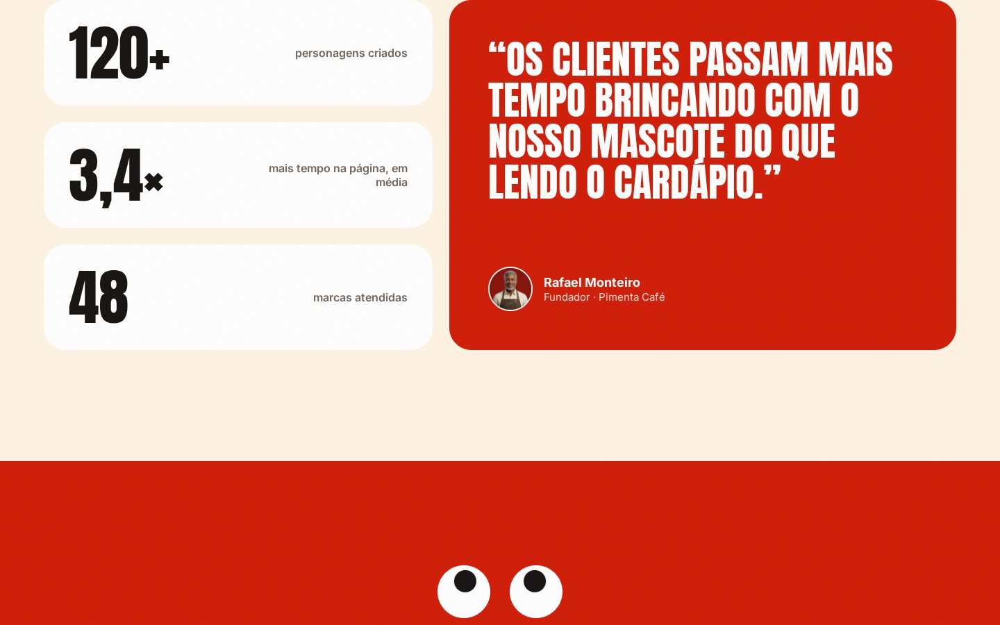
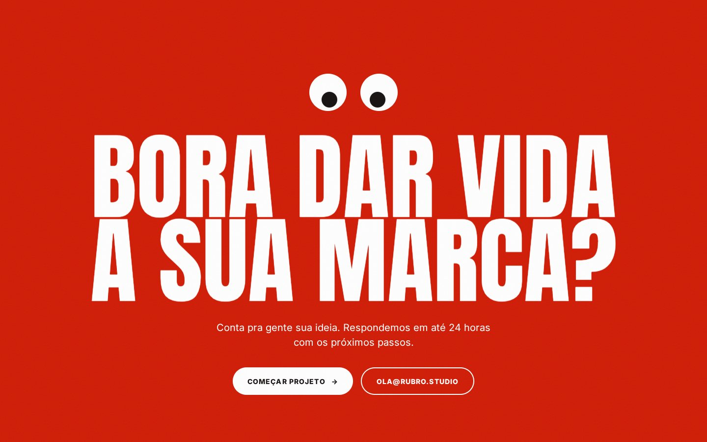
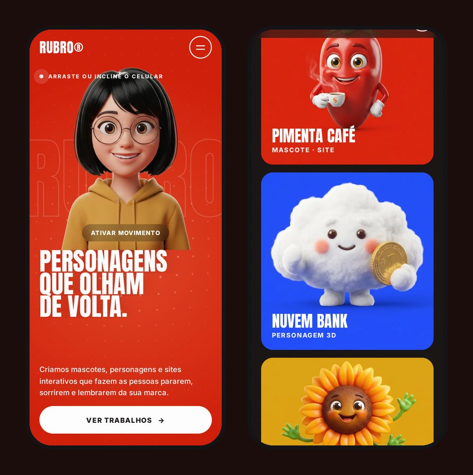

<div align="center">

# RUBRO®

### Personagens que olham de volta.

Landing page de um estúdio fictício de mascotes e personagens 3D. Quase tudo na página reage a quem está olhando.

**[rubro-studio.netlify.app](https://rubro-studio.netlify.app)**


</div>

---

## A ideia

Um estúdio que cria mascotes precisa de um site que pareça vivo. Então a personagem do hero se inclina na direção do cursor, os olhinhos do final seguem o mouse e piscam, e os cards se mexem quando o cursor passa por cima. No celular, o movimento vem do toque ou da inclinação do aparelho.

## O que acontece na página

**🖱️ Interações com o cursor**
- Personagem do hero com inclinação 3D e parallax, seguindo o mouse, o toque ou o giroscópio do celular
- Campo de pontos em canvas no fundo do hero, que se afasta do cursor
- Brilho que acompanha o mouse e a palavra "RUBRO" vazada em parallax
- Cursor customizado com o rótulo "Ver projeto" sobre os trabalhos
- Botões magnéticos que puxam o cursor
- Olhinhos do CTA que seguem o ponteiro e piscam sozinhos

**📜 Animações no scroll**
- Preloader com contador e cortina de abertura
- Títulos revelados linha por linha e texto que acende palavra por palavra
- Faixa (marquee) cuja velocidade e direção acompanham o scroll
- Cards de serviço com inclinação 3D e reflexo de luz
- Parallax nas imagens dos trabalhos
- Linha do processo desenhada pela rolagem e números que contam até o valor final



<table>
  <tr>
    <td></td>
    <td></td>
  </tr>
</table>



### No celular



## Por dentro

- **Sem framework:** HTML, CSS e JavaScript puro, empacotados pelo Vite.
- **GSAP + ScrollTrigger** cuidam das revelações, do parallax, da linha do processo e dos contadores. O **Lenis** deixa a rolagem suave.
- **Um único estado do ponteiro** (mouse, toque ou giroscópio) alimenta o hero, o campo de pontos, o brilho e os olhinhos. Assim tudo responde ao mesmo gesto.
- **Personagens gerados com IA.** O fundo da personagem principal foi removido com `scripts/cutout.py`, um recorte por chroma key em Python.
- **Acessibilidade:** respeita `prefers-reduced-motion`, tem foco visível no teclado e desliga o cursor customizado em telas de toque.

```
├── index.html          # todas as seções
├── src/
│   ├── main.js         # preloader, cursor, hero, campo de pontos, scroll, olhinhos
│   └── style.css
├── public/img/         # personagens e ilustrações
├── scripts/            # recorte do fundo (cutout.py) e utilitários de imagem
└── docs/               # imagens deste README
```

## Rodar localmente

```bash
npm install
npm run dev       # desenvolvimento
npm run build     # produção em dist/
```

## Créditos

Design, desenvolvimento e animações: **Giselly Pereira**.<br/>
Personagens e imagens gerados com IA. O Rubro, os clientes e os números são fictícios.
